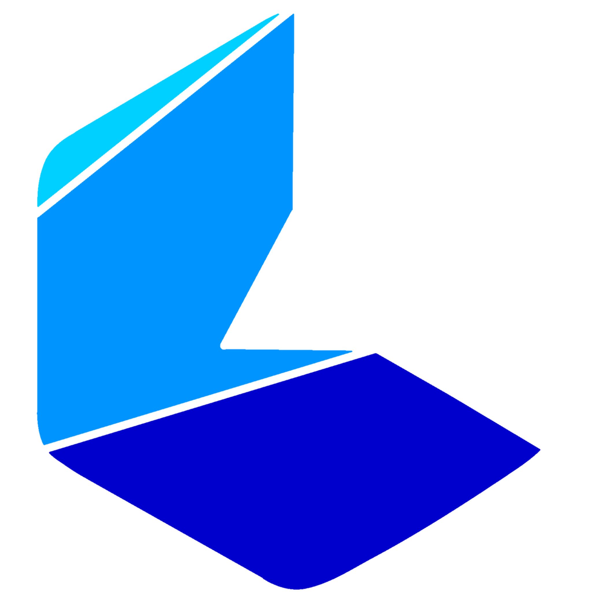

# 🏢 Crave HRM — SaaS Human Resource Management

<p align="center">
  
</p>

<p align="center">
  <strong>Solusi Manajemen SDM & Penggajian Multi-Company Berstandar Regulasi Indonesia</strong><br>
  Target Go-Live: <strong>29 November 2026</strong> &bull; Domain: <code>hrm.craveservices.my.id</code>
</p>

<p align="center">
  
  
  
  
  
  
</p>

---

## 👥 Tim Pengembang (RACI)

* **Eka Revandi** — Lead Project & Lead Software Engineer  
  *(Arsitektur Sistem, Multi-Company Tenancy, Keamanan Data, Engine PPh 21 TER 2024 & BPJS, Deployment)*
* **Egi Witra Aditya** — Project Manager & QA Lead  
  *(Roadmap Sprint, Prioritas Backlog, Verifikasi UAT, Quality Gate & Delivery Sign-off)*
* **Aufa** — Project Development  
  *(Pengembangan Fitur Fullstack, Komponen React 19 / Shadcn UI, Validasi Form, Alur Modul)*

---

## 🚀 Panduan Setup & Instalasi Proyek (Lokal / Tim Baru)

Ikuti langkah-langkah di bawah ini untuk mengklon repositori dan menjalankan aplikasi di komputer lokal:

### 1. Prasyarat Sistem (Prerequisites)
Pastikan perangkat Anda telah terpasang:
* **PHP:** Versi `>= 8.2` (disarankan PHP 8.3 dengan ekstensi `pdo`, `mbstring`, `openssl`, `curl`)
* **Composer:** Versi `>= 2.5`
* **Node.js:** Versi `>= 18` atau `>= 20` (LTS) & **npm**
* **Database:** MySQL / MariaDB (XAMPP / Docker / MySQL Server lokal)

---

### 2. Langkah Kloning & Instalasi Dependency

```bash
# 1. Klon repositori dari GitHub / Git Remote
git clone https://github.com/username/revan-laravel.git crave-hrm
cd crave-hrm

# 2. Instal seluruh dependensi backend (PHP Composer)
composer install

# 3. Instal seluruh dependensi frontend (Node.js npm)
npm install
```

---

### 3. Konfigurasi Environment & Database

```bash
# 1. Salin template konfigurasi .env
cp .env.example .env

# 2. Generate Application Key Laravel
php artisan key:generate
```

Buka file `.env` di teks editor favorit Anda, sesuaikan koneksi database Anda:
```env
APP_NAME="Crave HRM"
APP_URL=http://localhost:8000

DB_CONNECTION=mysql
DB_HOST=127.0.0.1
DB_PORT=3306
DB_DATABASE=crave_hrm
DB_USERNAME=root
DB_PASSWORD=
```

Buat database baru di MySQL (misal via phpMyAdmin atau terminal):
```sql
CREATE DATABASE crave_hrm CHARACTER SET utf8mb4 COLLATE utf8mb4_unicode_ci;
```

---

### 4. Eksekusi Migrasi & Data Seeder Awal

Jalankan perintah berikut untuk membuat skema tabel multi-tenant serta menyuntikkan data seeder awal (holding, anak perusahaan, cabang kantor, karyawan, dan akun tim):

```bash
# Jalankan migrasi dan seeding database
php artisan migrate --seed
```

Buat symlink direktori penyimpanan publik:
```bash
php artisan storage:link
```

---

### 5. Menjalankan Server Pengembangan (Dev Servers)

Buka **dua tab terminal**:

* **Terminal 1 (Backend Laravel API & Inertia):**
  ```bash
  php artisan serve
  ```
  *Server Laravel aktif di `http://127.0.0.1:8000`.*

* **Terminal 2 (Frontend Vite React 19 HMR):**
  ```bash
  npm run dev
  ```
  *Server Vite aktif dengan kompilasi otomatis dan Hot Module Replacement.*

Buka peramban Anda di: **`http://127.0.0.1:8000`**

---

### 🔑 Akun Pengujian Bawaan (Default Credentials)

| Akun / Nama | Email | Password | Role / Peran | Entitas Perusahaan |
| :--- | :--- | :--- | :--- | :--- |
| **Eka Revandi** | `founder@craveservices.my.id` | `@Mukbsca22` | `super_admin` | Crave Global Group (Holding) & Subsidiaries |
| **Egi Witra Aditya** | `egi@craveservices.my.id` | `password123` | `holding_admin` | Crave Global Group & Subsidiaries |
| **Aufa** | `aufa@craveservices.my.id` | `password123` | `company_admin` | PT Crave Layanan Digital |

---

## 🌿 Aturan Kerja Git (Branching & Pull Request Workflow)

> [!IMPORTANT]
> **DILARANG KERAS** melakukan *push* atau *commit* langsung ke branch `main`. Seluruh penambahan fitur dan perbaikan bug wajib melalui cabang fitur (*feature branch*) dan Pull Request (PR).

### Alur Kerja Kolaborasi Standar:

```
main ────────────────────────────── (Production & Verified Only)
  │                                    ▲
  │ (git checkout -b feature/...)      │ (Pull Request setelah QA Sign-off)
  ▼                                    │
feature/task-X-nama-fitur ─────────────┴──── (Pengerjaan & Uji Mandiri)
```

#### 1. Sinkronisasi Branch `main` Terbaru Sebelum Mulai
Setiap kali hendak mengerjakan task baru dari `docs/SPRINT.md`, selalu tarik update terbaru:
```bash
git checkout main
git pull origin main
```

#### 2. Buat Branch Baru untuk Task Anda
Gunakan penamaan branch yang jelas sesuai nomor task atau modul:
* Fitur baru: `feature/task-6-announcements` atau `feature/attendance-gps-selfie`
* Perbaikan bug: `bugfix/fix-tenant-isolation`
* Peningkatan performa / refactor: `refactor/payroll-ter-calculator`

```bash
git checkout -b feature/task-6-announcements
```

#### 3. Kembangkan Fitur Sesuai Aturan & Desain Crave POS
* Wajib membaca spesifikasi task bersangkutan di `docs/IMPLEMENTATION_PLAN.md` dan `docs/SPRINT.md`.
* Terapkan *skills* rekomendasi (misal: `frontend-ui-engineering`, `security-and-hardening`, `test-driven-development`).
* Patuhi batas estetika Crave POS: **dilarang membuat styling mentah atau badge warna-warni yang menyimpang dari Crave POS**.

#### 4. Verifikasi Lokal Wajib (Quality Gate Checklist)
Sebelum melakukan commit dan push, Anda **WAJIB** menjalankan pengujian otomatis dan build lokal:

```bash
# 1. Jalankan test suite PHPUnit (Wajib 100% Passed)
php artisan test

# 2. Jalankan kompilasi produksi Vite (Wajib 0 Error)
npm run build
```

Jika ada tes yang gagal atau terjadi error bundel Vite, perbaiki terlebih dahulu sampai semua berwarna hijau!

#### 5. Commit dan Push Branch ke Remote
Gunakan format commit pesan terstruktur (*Conventional Commits*):
```bash
git add .
git commit -m "feat(internal-mgmt): implementasi pengumuman internal dan kalender hari libur"
git push origin feature/task-6-announcements
```

#### 6. Buka Pull Request (PR) ke Branch `main`
1. Buka repositori di GitHub dan klik **Compare & pull request**.
2. Isi deskripsi PR dengan format berikut:
   * **Deskripsi Singkat:** Penjelasan mengenai fitur yang ditambahkan atau diubah.
   * **Task Terkait:** Merujuk ke Task X di `docs/SPRINT.md`.
   * **Hasil Pengujian:** Bukti bahwa `php artisan test` dan `npm run build` lolos.
3. Tetapkan *Reviewer*:
   * **Eka Revandi** (Lead SE) untuk review arsitektur & keamanan.
   * **Egi Witra Aditya** (PM / QA) untuk verifikasi kesesuaian sprint & UAT.
4. Setelah PR disetujui dan lulus review, lakukan **Merge** ke `main`.
5. Perbarui checklist status di `docs/SPRINT.md` dari `[ ]` menjadi `[x]` dan catat pada tabel *Daily Standup Log*.

---

## 🎨 Standar Desain Resmi (Crave POS Aesthetic Parity)

Crave HRM dibangun dengan bahasa desain resmi turunan dari **Crave POS Dashboard** (`crave-pos-dashboard/`):

* **Warna Utama (OKLCH):**
  * `Primary`: `oklch(0.54 0.19 258)` (Royal Electric Indigo Blue)
  * `Background`: `oklch(0.98 0.006 250)` (Slate kanvas bersih)
  * `Card Surface`: Pure White `oklch(1 0 0)` dengan border `oklch(0.91 0.014 252)`
  * `Text Primary`: Deep Slate Navy `oklch(0.22 0.03 258)`
* **Corner Radius:**
  * Container & Kartu: `24px` (`rounded-2xl` / class `@utility card-soft`).
  * Tombol & Input: `12px` (`rounded-xl`).
  * Status Badge: `rounded-full`.
* **Pola UI Bebas "AI Slop":**
  * Kartu KPI statistik: Hanya kartu pertama (Hero) yang berwarna `bg-primary`, kartu lainnya putih bersih `bg-card border-border/50`.
  * Item daftar karyawan / aktivitas: Menggunakan container bersih `grid grid-cols-[minmax(0,1fr)_auto] items-center gap-3 rounded-xl bg-muted/50 p-3`.
  * Seluruh komponen interaktif wajib menggunakan **Shadcn UI** asli yang sudah terinstal di `resources/js/components/ui/`.

---

## 🔒 Aturan Keamanan & Multi-Tenancy (Strict Rule)

1. **Isolasi Data Multi-Perusahaan:**
   * Setiap data operasional (karyawan, absensi, gaji, cuti, klaim) wajib diikat dengan `company_id`.
   * Model Eloquent wajib menyertakan trait `BelongsToCompany` agar kueri otomatis tersaring berdasarkan perusahaan yang aktif di session pengguna (`session('active_company_id')`).
   * Dilarang keras menampilkan atau memanipulasi data entitas perusahaan lain (*zero cross-tenant data leakage*).
2. **Kerahasiaan Data Sensitif:**
   * NIK KTP, nomor rekening bank, dan besaran gaji karyawan wajib terenkripsi.

---

## 📂 Dokumentasi Teknis Tambahan

Dokumentasi arsitektur dan perencanaan kerja lengkap tersimpan di folder `docs/`:
* 📘 [`docs/PRD.md`](docs/PRD.md): Spesifikasi 9 modul inti, kalkulasi PPh 21 TER 2024, BPJS, formula lembur PP 35/2021, dan token visual.
* 🛠️ [`docs/IMPLEMENTATION_PLAN.md`](docs/IMPLEMENTATION_PLAN.md): Rincian teknis 14 task pengembangan bertahap.
* 📅 [`docs/SPRINT.md`](docs/SPRINT.md): Roadmap 3 Sprint, RACI tim, checklist interaktif, rekomendasi skills AI, dan catatan standup harian.
* 🛡️ [`AGENTS.md`](AGENTS.md) / [`CLAUDE.md`](CLAUDE.md): Aturan operasi mutlak untuk AI Agent / Assistant.

---

<p align="center">
  Dikelola dengan ❤️ oleh <strong>Tim Pengembang Crave HRM</strong><br>
  <em>Crave Services &bull; 2026</em>
</p>
